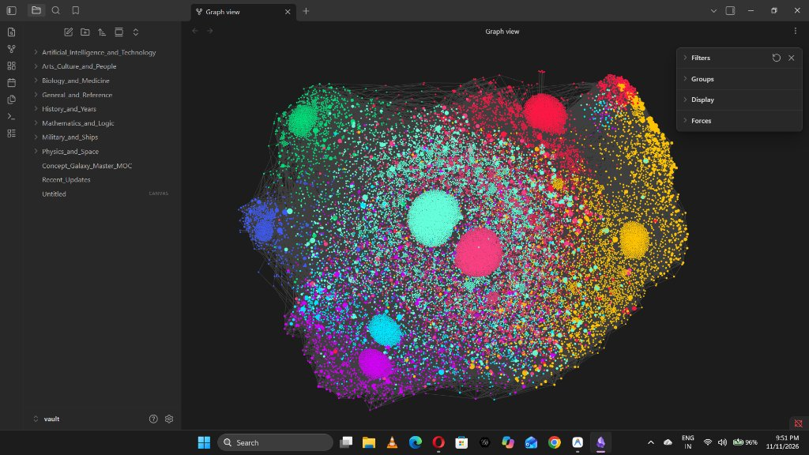

# 🌌 Wikipedia Galaxy

> **Turn raw Wikipedia dumps into a local, interconnected Obsidian 3D Knowledge Universe.**



[-00e5ff?style=for-the-badge&logo=obsidian&logoColor=white)](https://github.com/arsh240311/wikipedia-galaxy/releases/download/v1.0.0/wikipedia-galaxy-vault.zip)
[](https://github.com/arsh240311/wikipedia-galaxy)
[](LICENSE)

**Wikipedia Galaxy** is an open-source data pipeline and ready-to-use knowledge universe that transforms raw Wikimedia XML dumps into an interconnected offline Obsidian vault with a pre-tuned 3D cosmic graph network.

---

## ⚡ Instant Download (No Coding Required)

Don't want to run Python scripts or download multi-gigabyte Wikipedia dumps? We've already parsed and built a ready-to-explore **21,000+ article universe** for you!

1. **[Download `wikipedia-galaxy-vault.zip` (195 MB)](https://github.com/arsh240311/wikipedia-galaxy/releases/download/v1.0.0/wikipedia-galaxy-vault.zip)**
2. Unzip the archive.
3. Open Obsidian -> click **"Open folder as vault"** -> select the unzipped folder.
4. Press `Ctrl + G` (Graph View) to witness your personal 21,000-node Cosmic Nebula!

---

## 🛠️ Features (For Builders & Hackers)

- **🚀 Memory-Flat XML Streaming:** Streams gigabyte-scale `.xml.bz2` Wikipedia dumps using `iterparse` and `bz2file`. Memory stays flat regardless of dump size.
- **🔗 Automatic `[[Wikilinks]]` Extraction:** Parses MediaWiki syntax via `mwparserfromhell`, extracts outgoing links, and linkifies core keyword occurrences into native Obsidian backlink syntax.
- **📂 NTFS-Safe Deep Tree:** Partitions thousands of articles into structured alphabet matrices (`A/B/Article.md`) to prevent Windows NTFS and Linux ext4 from choking on single-directory file limits.
- **🗺️ Gephi & Graph CSV Export:** Generates clean `Source, Target` connection pairs (`wikipedia_galaxy.csv`) ready for Gephi, Cosmograph, or network analysis engines.
- **🎨 Pre-Tuned Nebula Graph Preset:** Bundles a pre-configured `graph.json` with domain color groups (Physics, AI, Military, History, Biology) for Obsidian's Graph View.

---

## 📦 Requirements & Pipeline

```bash
pip install -r requirements.txt
```

### 1. Download a Wikipedia Dump Chunk
Download any Wikimedia multistream article chunk (e.g. from [Wikimedia Dumps](https://dumps.wikimedia.org/enwiki/latest/)):

```bash
# Example chunk:
# enwiki-latest-pages-articles-multistream1.xml-p1p41242.bz2
```

### 2. Configure Paths
Open `build_galaxy.py` and set your input/output paths:

```python
DUMP_PATH = "path/to/your/enwiki-dump.xml.bz2"
OUTPUT_VAULT = "./vault"
CSV_PATH = "./wikipedia_galaxy.csv"
```

### 3. Build the Cosmic Web
Run the streaming extractor:

```bash
python build_galaxy.py
```

---

## 🎨 Nebula Color Palette Preset

| Domain | Color | Hex |
| :--- | :--- | :--- |
| **Physics & Space** | Electric Cyan | `#00e5ff` |
| **Military & Ships** | Crimson Red | `#ff1744` |
| **History & Years** | Deep Amber | `#ffc400` |
| **AI & Technology** | Neon Green | `#00e676` |
| **Biology & Medicine** | Neon Violet | `#d500f9` |
| **Mathematics & Logic** | Electric Indigo | `#3d5afe` |
| **Arts & Culture** | Rose Pink | `#ff4081` |
| **General Reference** | Silver Mint | `#64ffda` |

---

## 📜 License

MIT License. Free to use, fork, and modify.
